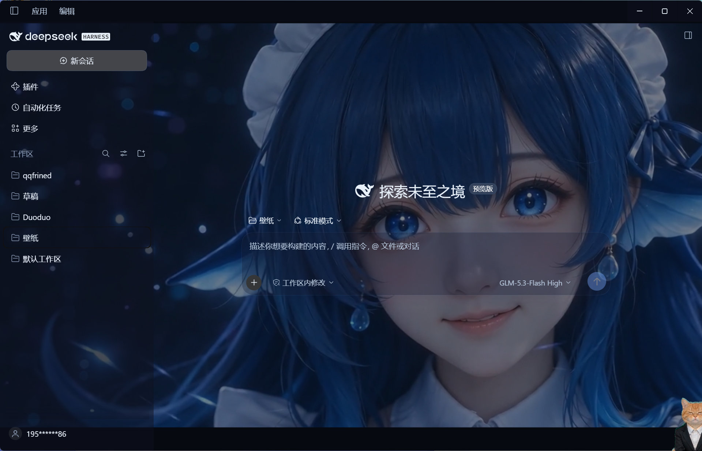

# dsh-oceaneyes

给 DeepSeek Harness Web GUI 用的「开机动画 + 循环视频壁纸」宿主插件。

**自包含发行版**：两个视频文件随插件包一起分发（`media/` 目录），
拿到包之后跑一次 `install.ps1`，重启 DSH 就能用，不依赖任何本机路径。

打开 DSH 的那一刻，页面里**只有视频**，输入框、左侧栏、整个 React 界面都不存在；
1.5 秒后操作界面淡入；开机视频播完后自动交叉淡入到第二个视频，第二个视频静音循环、
铺满整屏当壁纸，不挡点击、不影响任何操作。

> 一款为 DSH 打造的深海鲸鱼娘主题动态壁纸插件，包含**启动壁纸 + 常驻壁纸**两套画面，搭配深邃空灵的氛围感启动音效。
>
> 启动页：少女睁眼，环绕幽蓝流光，镜头前推，伴随深海氛围感音效，沉静温柔；
> 常驻页：澄澈蓝眸注视，星光点点，静谧梦幻。
> 整体以深海蓝为主色调，融合人鱼鳍耳、水滴坠饰、微光粒子等元素，给桌面带来沉浸式的海底星河体验。

| 启动页（少女睁眼 · 幽蓝流光） | 常驻壁纸（澄澈蓝眸 · 星光点点） |
| --- | --- |
|  |  |


```
0ms ──────────── 约 1.5s ──────── 约 2s ─────── 4.5s ────────── ∞
│ 视频① 全屏，无任何 UI │ UI 淡入(450ms) │ 视频① 继续 │ 交叉淡化(300ms) │ 视频② 循环
```

## 它怎么做到的

全部在**宿主侧**完成，不依赖浏览器端插件加载 UI：

| 手段 | 作用 |
| --- | --- |
| `webserver/index-inject` 注入 `<style>` / `<script>`（head）+ `<div id="dsh-wp">` / `<script>`（body） | 这些行由服务端直接写进 `index.html`，在 `<div id="root">` **之前**，首帧就是视频 |
| `webServer.register({kind:'prefix', path:'/wallpaper/media'})` | 自己实现带 HTTP Range 的视频流（包 assets 路由只支持 svg/png/webp/jpg/jpeg） |
| `html[data-dsh-wp="boot"] #root{visibility:hidden}` | 开机阶段整个界面不可见，而不是盖一层遮罩，避免两层动画不同步 |
| `--dsw-*` 玻璃令牌覆盖 + `body` 透明 | 侧栏、输入框、气泡、菜单变成半透明玻璃，壁纸从背后透出来，文字对比度不变 |

## 下载即用（三步）

0. 从 [Releases](../../releases) 下载最新的 `dsh-oceaneyes-<版本>.zip`。
1. 解压发行包，得到 `dsh-oceaneyes\`（插件本体）和 `install.ps1`。
2. 在解压目录打开 PowerShell，运行：
   ```powershell
   .\install.ps1                    # 装进桌面 App 的 profile（默认 desktop）
   .\install.ps1 -Profiles desktop,web   # 或指定多个 profile
   .\install.ps1 -Remove            # 卸载
   ```
   脚本做的事：把插件包复制到 `%USERPROFILE%\.dsh\plugins\dsh-oceaneyes`，
   在所选 profile 的 `package.json` 里登记 `link:` 依赖、把 `dsh-oceaneyes`
   加进 `dsh.profile.bundles`、并在 `node_modules` 里建目录联接——
   和手工安装完全一致，只是自动做了一遍。
3. **重启 DeepSeek Harness**（宿主插件在启动时装配），开机动画即生效。

> 手动安装（不用脚本）：等价于把 `dsh-oceaneyes` 放到任意固定位置，
> 在 profile `package.json` 写 `"dsh-oceaneyes": "link:<路径>"`、
> 在 `dsh.profile.bundles` 里加 `"dsh-oceaneyes"`、在 profile `node_modules`
> 里建指向该目录的 junction。

## 装在哪个 profile（关键）

DSH 有**两套** profile，别装错：

| 入口 | profile | 说明 |
| --- | --- | --- |
| 桌面 App（双击 DeepSeek Harness.exe） | `~/.dsh/profiles/desktop` | 平时用的就是这个，默认装这里 |
| 命令行 `dsh web` | `~/.dsh/profiles/web` | 只是 `dsh web` 启动的独立实例 |

桌面 App 和普通 `dsh web` 的注入时机**不一样**：桌面端直接从
`app.asar` 里的 `dsh-web-frontend/dist/index.html` 加载页面，服务端渲染的
`index.html` 不参与，所以注入行是由前端在拿到 `dshDesktopBoot.ready()` 的
`injections` 之后、在 React 挂载之前用 `applyInjections` 逐条应用的
（`style` / `script(head)` / `html(body)` / `script(body)` 四种都支持）。
这也解释了为什么只装 `web` profile 时桌面 App 没反应。

## 目录

```
dsh-oceaneyes-<版本>.zip
├─ install.ps1                  一键安装/卸载脚本
├─ 安装说明.txt                  上面「下载即用」的简版
└─ dsh-oceaneyes\              插件包（自包含）
   ├─ package.json             清单（1.0.0 起，exports 带 locale 与 icon）
   ├─ cordis.patch.yml         默认配置（时长、透明度、文件名…）
   ├─ lib\index.js             全部逻辑，纯 ESM，无打包
   ├─ media\video1.mp4         开机动画（随包分发）
   ├─ media\video2.mp4         循环壁纸（随包分发）
   ├─ locale\en.json|zh.json   插件管理器里的标题/描述
   ├─ icon.svg                 插件图标
   ├─ docs\                    效果截图
   └─ README.md                本文件
```

## 配置

改 `dsh-oceaneyes\cordis.patch.yml` 里的 `config:`，然后**重启 DSH**（宿主插件在启动时装配）：

| 键 | 默认 | 说明 |
| --- | --- | --- |
| `enabled` | `true` | `false` = 完全不注入任何东西 |
| `mediaDir` | `media` | 视频所在目录。**相对路径按插件包根解析**（默认即包内 `media\`）；写绝对路径可换成任意目录 |
| `bootVideo` / `loopVideo` | `video1.mp4` / `video2.mp4` | 两个文件名（只允许这两个，防目录穿越） |
| `splashMs` | `1500` | 视频① 独播多久后 UI 淡入（从视频真正开始播放算起） |
| `fadeMs` | `450` | UI 淡入时长 |
| `crossfadeMs` | `300` | ①→② 交叉淡化时长 |
| `scrim` | `rgba(0,0,0,0.28)` | UI 显形后压在整个壁纸上的薄纱，`''` 关掉 |
| `objectFit` | `cover` | `cover` 铺满裁切 / `contain` 完整留黑边 |
| `panelAlpha` | `0.62` | 玻璃面板不透明度。想让壁纸更透就调到 `0.45`，想文字更清楚就 `0.8` |
| `surfaces` | `tokens` | `off` = 不覆盖任何 `--dsw-*` 令牌（面板恢复不透明，壁纸只在缝隙里可见） |
| `pauseWhenHidden` | `true` | 切到后台标签时暂停壁纸，省电 |
| `audio` | `false` | 播放视频自带的声音。默认静音；打开后若被浏览器/Electron 拦掉有声自动播放，会自动退回静音只留画面 |
| `volume` | `0.6` | `0~1`，只在 `audio: true` 时生效 |
| `nowallpaperParam` | `nowallpaper` | `?nowallpaper=1` 跳过整套壁纸 |

## 临时关掉壁纸

三种办法，都不用改配置：

- 地址栏加 `?nowallpaper=1`（**先正常打开过一次**再改，首次带 token 的地址 303 会丢掉 query）
- 控制台执行 `localStorage['dsh-oceaneyes']='off'` 后刷新；改回 `'on'`
- 把 `cordis.patch.yml` 里 `enabled: false`

## 改完代码 / 换视频之后

- 换视频：覆盖**已安装副本**里的同名文件
  （`%USERPROFILE%\.dsh\plugins\dsh-oceaneyes\media\`，开发机上是包内 `media\`），
  然后**刷新页面**（Ctrl+R）就行 —— 视频是每次请求从磁盘现读的
  （`cache-control: no-store`，ETag 随文件变），既不用重装也不用重启。
  换文件名才需要改 `cordis.patch.yml` 的 `bootVideo` / `loopVideo` 并重启。
- **编码必须是浏览器能解的**：`mp4 / H.264 + AAC`（最稳）或 `webm / VP9`、`AV1`。
  **HEVC（`hvc1`/`hev1`）这套 Chromium 解不了**（实测 `canPlayType` 直接返回空），
  容器能读、`readyState` 也能到 4，但 `videoWidth` 恒为 0 —— 表现就是**纯黑**。
  遇到这种情况插件会打一条 `[dsh-oceaneyes] cannot decode …` 的警告，并直接跳过开机动画，
  用②当壁纸（不会让你对着黑屏等 4.5 秒）。
- 改插件代码：不用重装（依赖是 `link:` 目录联接，指向已安装副本，改了就生效），
  但宿主插件是启动时装配的，改完要**重启 DSH**。

## 验证（不启动桌面端，另起一个实例看）

```powershell
& "C:\Users\86195\AppData\Local\Programs\DeepSeek Harness\resources\runtime\cli\bin\dsh.cmd" `
  --profile web --port 0 --no-open
# 会打印 http://127.0.0.1:<port>/?token=...
& "D:\nodejs\node.exe" "D:\DSH\壁纸\_tmp\httpcheck.mjs" "<那个地址>"
```

`_tmp\shot.mjs`（无头 Edge + CDP 截图）、`_tmp\probe.mjs`（探测 DOM/令牌）、
`_tmp\check.mjs`（离线验证注入与 Range 逻辑）都留着，可删。

## 已知取舍

- 两个 mp4 的 `moov` 在文件末尾（非 faststart）。本地 127.0.0.1 + Range 已经够快，
  首帧大约 0.4~0.6s；UI 的 1.5s 是从「视频真正开始播」起算，所以这个延迟不会吃掉动画。
- ②→② 的循环接缝取决于视频本身，无缝需要重新编码（本机没装 ffmpeg）。
- 玻璃面板是「半透明 + 薄纱」，不是毛玻璃模糊：模糊需要 `backdrop-filter`，得逐个命中
  有哈希类名的面板元素，版本升级就会失效，所以没做。
- 右侧面板最大化时，**被它盖住的中栏会整栏隐藏**（`visibility:hidden`）。否则中栏文字会
  从玻璃面板下面透上来，两栏字叠在一起。隐藏的是「下一个兄弟是 `[data-rightbar-col]`
  的那个 div」，靠 `:has(+ …)` 定位，不依赖 `mP3x-q_*` 这类哈希类名。副作用：最大化期间
  看不到对话（本来也被盖住了），退出最大化立刻恢复。
